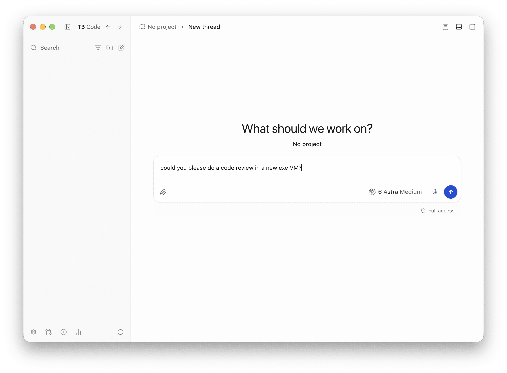

# t3exe

Run [T3 Code](https://github.com/pingdotgg/t3code) agents in the cloud: your T3 Code hands tasks to new
[exe.dev](https://exe.dev) VMs and cleans them up after.

## Setup

You need T3 Code 0.1.10 or later, Node.js 22.18 or later, and `ssh exe.dev` working. On the machine with your
T3 Code, in your project's checkout, run:

```sh
npx -y @exedev/t3exe login
```

That's all of the setup. It makes an exe.dev API key that only works on VMs tagged `t3exe`, adds t3exe to
Claude Code and Codex, turns on Linked environments in T3 Code, and lets VMs clone your GitHub repository.

## How to use it

Start a new thread and ask for a VM:



The agent starts a VM with your T3 Code version, your repository and Claude Code and Codex on it, links it to
your T3 Code, and hands it the task with `delegate_task`. When the task ends, your thread gets the result.
t3exe deletes the VM once its threads have been idle for 15 minutes.

## More

The agent's tools are `exe_vm_create`, `exe_vm_list`, `exe_vm_destroy`, `exe_vm_pause`, `exe_vm_resume` and
`exe_vm_configure` (for when a VM is paused or deleted), with the same commands on the CLI (`t3exe --help`).
VMs are deleted after 8 hours unless kept, and agents on them use exe.dev's
[LLM integration](https://exe.dev/docs/integrations-llm) unless you forward your own keys with
`T3EXE_FORWARD_ENV`. Each VM's T3 Code is public at `https://<vm>.exe.xyz`, because a T3 Code link can't
sign in to exe.dev; T3 Code's own one-time pairing code protects it. `t3exe logout` undoes `login`, and
`t3exe --help` lists the environment variables t3exe reads. For T3 Code running on an exe.dev VM and the
details, see [exe.dev/deploy/t3exe](https://exe.dev/deploy/t3exe).

## License

MIT
